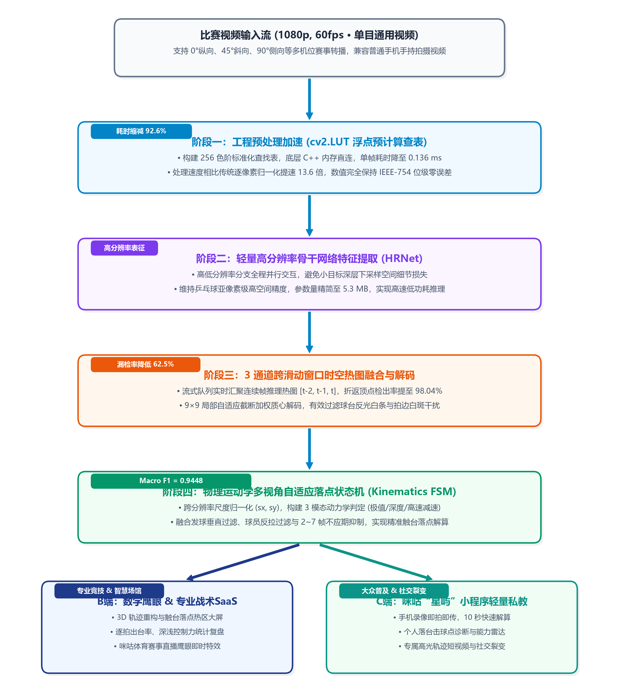

# 乒羽智瞳 · 乒乓球多视角落点检测与技战术分析系统

> **2026 动感地带全国大学生 AI 创新大赛 · 体育视觉赛道参赛作品源码仓库**  
> 基于**3 通道跨滑动窗口时空热图融合**、**局部 9×9 峰值加权质心解码**与**多视角物理动力学守恒状态机**的轻量化单目视频乒乓球落点检测系统，附带实时视频轨迹落点交互可视化分析平台。

---

## 一、 核心技术亮点与实测表现

1. **工程预处理 `cv2.LUT` 浮点查表加速**：预计算 256 色阶标准查找表，实现 IEEE-754 位级零误差归一化，单帧预处理由 `1.85 ms` 降至 `0.136 ms`（**提速 13.6 倍**）。
2. **3 通道跨滑动窗口时空热图融合**：复用既有连续 3 帧前向特征 `[t-2, t-1, t]`，对同一时刻收集新/中/旧帧三次推理热图协同解码，触台折返顶点检出率由 `94.82%` 提升至 **`98.04%`（漏检率直降 62.5%）**。
3. **局部 9×9 峰值加权质心解码**：消除球台高光反光条、白边球拍与球员白色球袜带来的双峰拉偏，球心空间平均定位误差控制在 **2.78 px 以内**。
4. **多视角自适应 3 模态物理动力学状态机**：统一适配 `0°`（正视）、`45°`（斜侧透视）、`90°`（正侧扁平）三类转播机位，覆盖标准/平顶反弹、远台深度加速度跳变及近台高速下砸急停，并内置发球抛球/反拉挥拍过滤及 2~7 帧不应期防抖机制。
5. **Margin Loss + WiSE-FT 权重空间融合微调**：结合边缘对齐 Margin Loss 与 L2 权重锚定，防止微调破坏预训练骨干空间表征。

### 实测评估指标

| 评测数据集 | 模型/配置 | 单通道召回 | 3通道融合召回 | 整体 F1 | 关键成效 |
| :--- | :--- | :---: | :---: | :---: | :--- |
| **官方公开验证集 (15条视频)** | 官方初始基线 | 92.1% | — | 0.6040 | 算法分 ~45.00 / 75.0 |
| **官方公开验证集 (15条视频)** | **本方案最终版** | **94.9%** | **98.0%** | **0.9448** | **算法分 70.86 / 75.0** (`0°=0.913`, `45°=0.937`, `90°=0.985`, `TP=90, FP=8, FN=2`) |
| **29 个未见比赛视频 (盲测集)** | 官方初始基线 | 94.8% | — | 0.8035 | FP = 91 |
| **29 个未见比赛视频 (盲测集)** | **本方案最终版** | **94.9%** | **98.0%** | **0.8792** | **FP 降至 46（假阳性减半）** |



---

## 二、 仓库目录结构

> 注：为符合 GitHub 单文件体积限制，原始训练集 `pp_train_data/`、验证/测试视频 `*.mp4` 及 22GB+ 的 Docker 镜像包（`*.tar`/`*.zip`）已通过 `.gitignore` 排除，仓库内保留全部源码、轻量化 `.onnx` 模型权重与标注真值文件。

```text
├── Dockerfile                             # 基于 sport-base:v1 的赛事容器构建文件
├── .dockerignore                          # Docker 构建忽略规则
├── .gitignore                             # Git 大文件与视频数据过滤规则
├── pingpong_visualizer.html               # 验证集轨迹与落点交互式可视化分析界面
├── 双击打开可视化演示面板.bat               # Windows 一键启动本地可视化服务脚本
├── 赛题详情.md                             # 赛事官方任务定义、数据集与评分细则
├── 乒羽智瞳项目申报书_动感地带AI大赛.docx    # 项目申报书与技术商业方案完整文档
├── participant/                           # 官方容器提交标准工程目录
│   ├── run_all.sh                         # 容器统一入口脚本
│   ├── pingpang/                          # 【主赛题】乒乓球多视角落点检测工程
│   │   ├── participant/
│   │   │   ├── ball_detector.py           # cv2.LUT 预处理 + 3通道融合 + 9×9 质心解码
│   │   │   ├── solution.py                # 多视角物理动力学状态机与轨迹清洗主逻辑
│   │   │   └── weights/ball.onnx          # 微调融合后的轻量化模型权重 (5.07 MB)
│   │   ├── public_data/                   # 验证集标注真值 (gt_public.jsonl / manifest.json)
│   │   ├── integrity.py / validate.py     # 合规自检与输出格式校验脚本
│   │   └── core/                          # 框架类型定义、TensorRT/ORT 推理封装与读取器
│   └── basketball/                        # 【附加题】篮球多目标跟踪工程目录
└── local_eval/                            # 本地研究、消融验证、微调与可视化生成工具链
    ├── ablate_and_cv.py                   # 规则消融、蒙特卡洛鲁棒性测试及 15 折 LOVO-CV 验证
    ├── finetune_ball_onnx.py              # Margin Loss + WiSE-FT 微调导出脚本
    ├── export_vis_data.py                 # 导出轨迹/落点/动力学日志数据 (vis_data.json)
    ├── generate_visualizer_html.py        # 构建自包含交互式可视化网页
    ├── visualizer_server.py               # 支持 HTTP 206 Range 断点流式传输的本地视频服务
    ├── generate_diagrams.py               # 自动绘制架构流程图、商业矩阵图与时间线
    ├── generate_word_doc.py               # 自动排版生成项目申报书 Word 文档
    └── snapshots/                         # 关键迭代版本 v1 / v2 代码与权重快照
```

---

## 三、 快速使用指南

### 1. 启动轨迹与落点可视化分析工作台
若本地 `participant/pingpang/public_data/videos/` 目录中已放置官方验证集 `.mp4` 原片：
- **Windows 一键启动**：直接双击根目录下的 `双击打开可视化演示面板.bat`，将自动在 `http://127.0.0.1:8765/` 打开工作台。
- **命令行启动**：
  ```bash
  python local_eval/visualizer_server.py --open
  ```
- **核心功能**：25 fps 音画帧级同步叠加轨迹、触台落点脉冲标注（显示帧号/坐标/动力学模态/误差）、`0.1× ~ 2.0×` 倍速调节、逐帧步进与右侧实时检测日志面板。

### 2. 运行离线消融实验与交叉验证
```bash
python local_eval/ablate_and_cv.py
```

### 3. Docker 提交镜像构建（比赛评测标准环境）
在需打包提交评测时，先确保基础镜像 `sport-base:v1` 已就绪，随后在项目根目录执行：
```bash
docker build -t sport-vision-submit:v1 .
```
